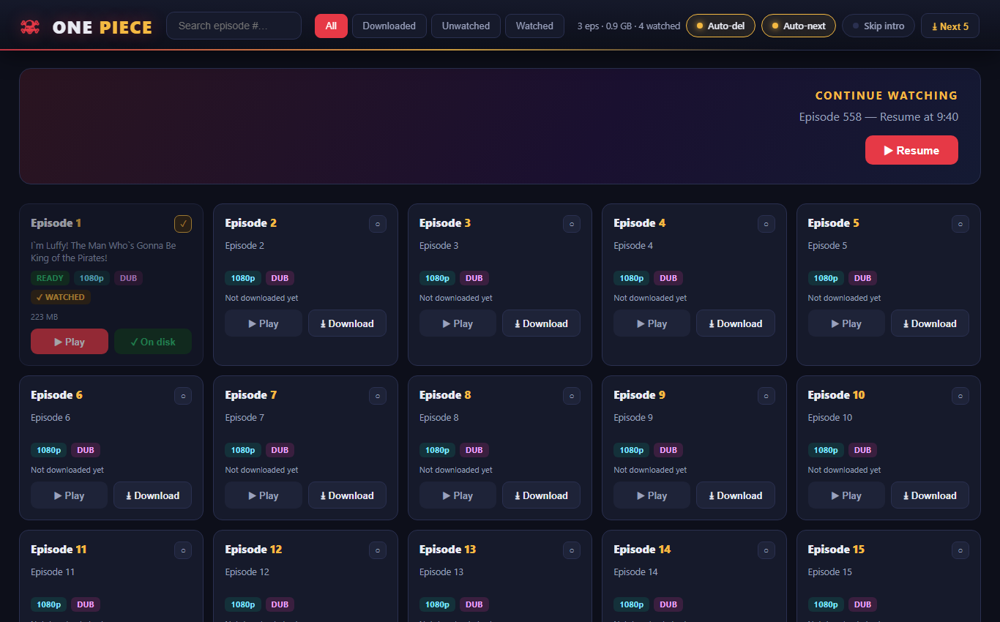
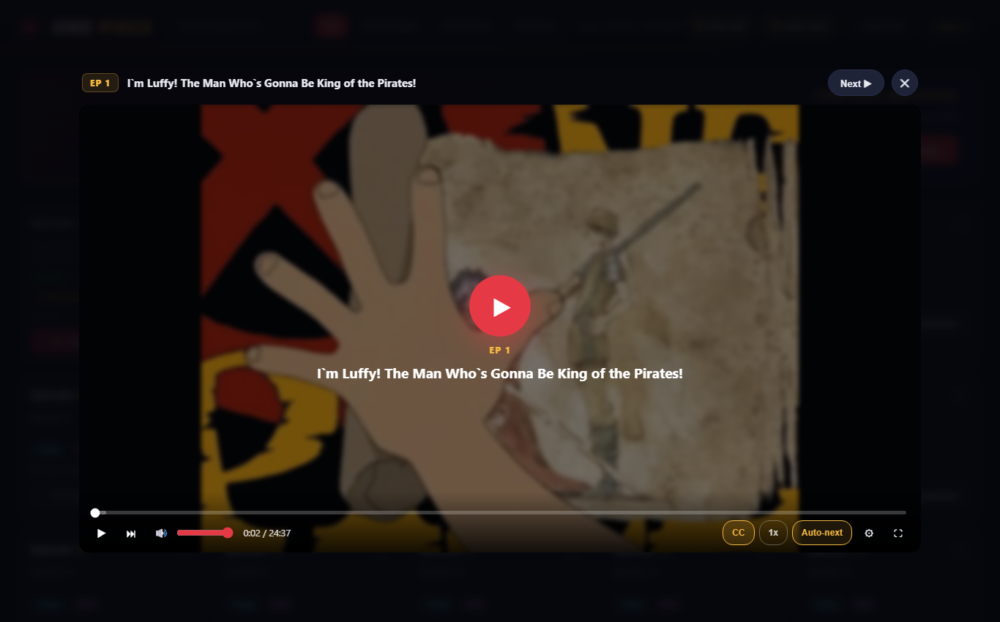
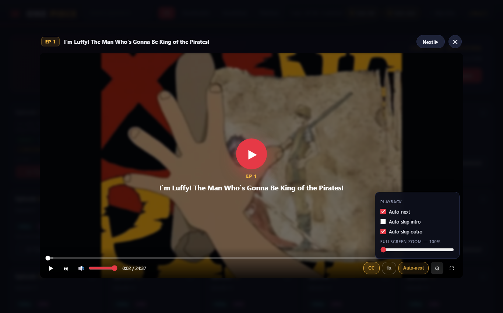
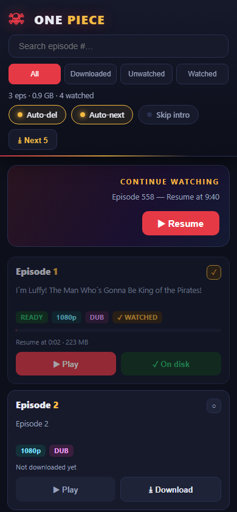

# one-piece-stream

A little self-hosted streaming server for One Piece. Downloads episodes in
1080p from an embed source, stitches them into a single mp4, and serves them
through a small netflix-style web ui on your local network. It keeps track of
what you watched, resumes where you left off, and quietly downloads the next
episode while you're watching the current one.

I made this for personal use so I could binge on a flight with no internet.
Don't use it to redistribute anything, it's all served on your own lan.

## screenshots

home page:

the player, paused (that big button is the custom pause overlay):

player settings menu (speed, toggles, fullscreen zoom):

phone layout:

## how it works

the funny part: the stream segments from the cdn are actually png images with
the real mpeg-ts data appended after the image end marker. some kind of
hotlink protection. so the downloader fetches each "segment" (a dozen or so
in parallel), cuts everything up to and including the png IEND chunk, and
writes the clean .ts files to a per-episode folder. ffmpeg then remuxes
straight from those files into a single mp4 with the concat demuxer
(-c copy, no re-encode) — no giant intermediate .ts, no triple disk pass.

getting the stream url is plain http: the getSources token sits right in the
embed page html, so no browser is needed at all (used to drive headless
chromium through playwright — dropped).

## watch while downloading

an episode is playable the moment it starts downloading: the server serves
the in-flight segments as a live HLS playlist (hls.js is bundled locally),
so you hit play on a 20%-done episode and it just plays, then hops over to
the final mp4 when the download finishes. segments are kept when you cancel,
so a retry resumes where it stopped instead of starting over.

## features

- 1080p downloads (dub or sub), stitched to a clean mp4
- watch-while-downloading via HLS + auto-switch to the finished mp4
- several episodes download at once, with live MB + speed readout and cancel
- resume anywhere — per episode watch progress, survives restarts
- auto-mark episodes watched after 5 minutes
- auto-delete oldest watched episodes to keep disk usage down (toggle in header)
- continue watching banner always points at the furthest episode you reached
- custom player controls that also work in fullscreen:
  - seek bar with buffered indicator, volume, playback speed menu
  - subtitle settings: on/off, timing offset, text size, background opacity
  - skip intro / skip outro buttons (timestamps come from the source)
  - auto-next rolls into the next episode at the start of the outro
- downloads the next episode automatically once you're ~2 minutes into one
- "next 5" button queues a batch of upcoming episodes
- phone friendly layout, add to home screen

## setup

needs python 3.10+ and ffmpeg on PATH:

    pip install flask requests
    python server.py

then open http://localhost:8000 (or http://your-pc-ip:8000 from your phone).
downloads folder and watched state are created automatically.

## config

`config.json` (optional):

    { "last_episode": 1150, "auto_delete": true,
      "dl_parallel": 2, "dl_workers": 10 }

`dl_parallel` = episodes downloaded at the same time, `dl_workers` = parallel
segment connections per episode. lower them if the source starts rejecting
you.

`server.py` constants worth knowing:

    WATCH_AFTER_SEC = 300   # seconds of watching before an ep counts as watched
    KEEP_WATCHED    = 2     # how many watched eps to keep on disk

## notes

- if a download fails mid-way just hit retry — it resumes from the segments
  it already has (cancelled downloads keep theirs too)
- the stream tokens expire fast, so the downloader re-resolves the playlist
  for every episode

## files

    server.py    flask app: api, streaming, HLS-for-downloads, watch state
    dl.py        the downloader (requests + ffmpeg)
    static/      the ui (plain html/css/js, hls.js vendored)
    start.bat    windows shortcut that starts the server and opens the browser
